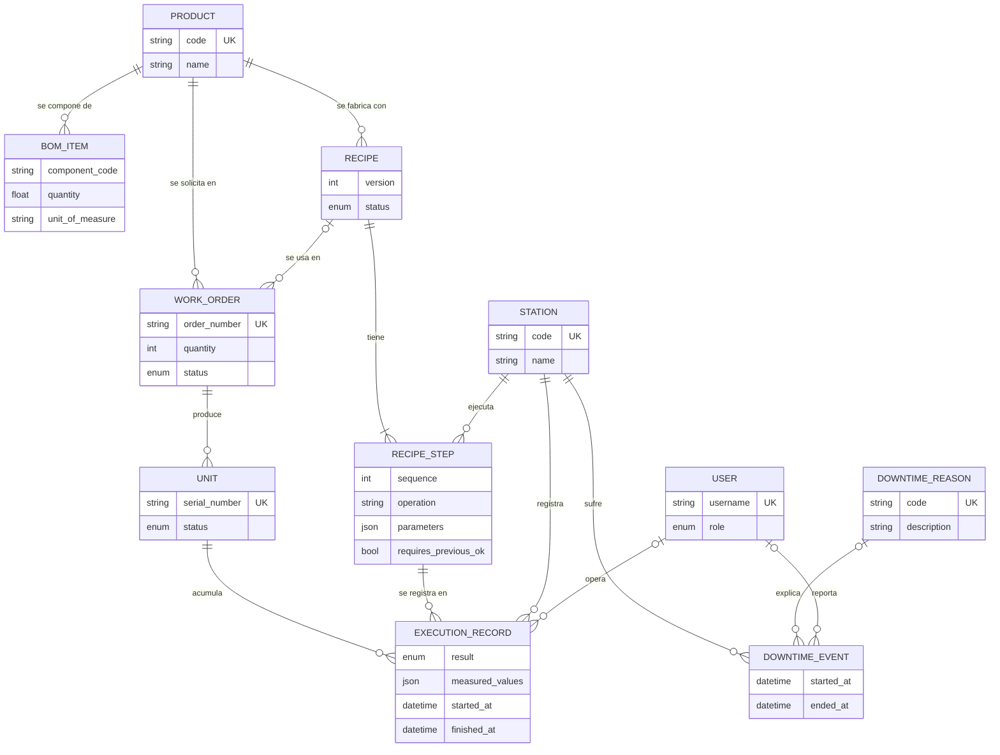
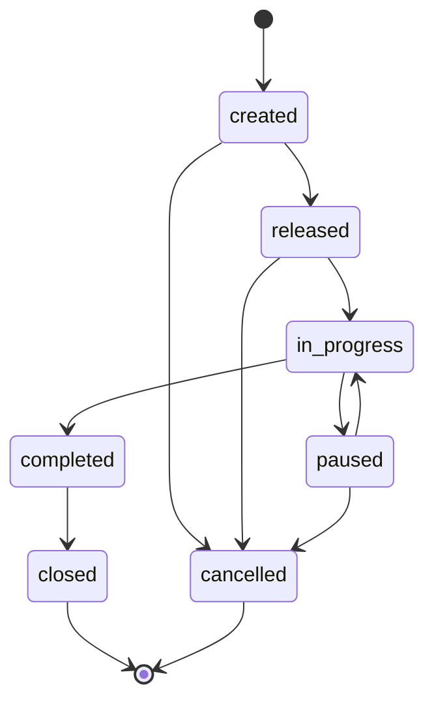
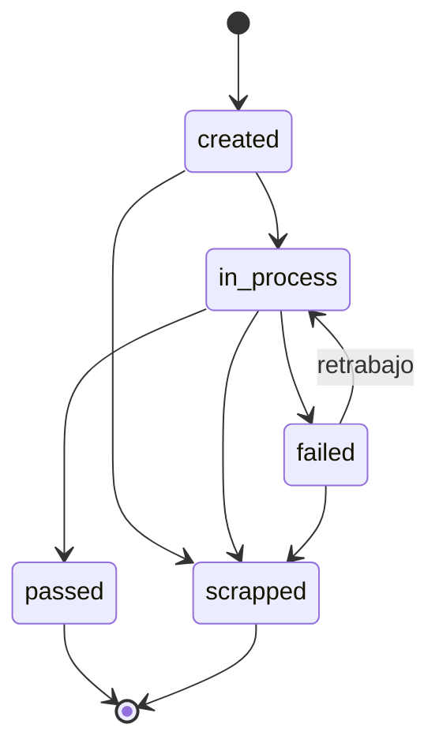
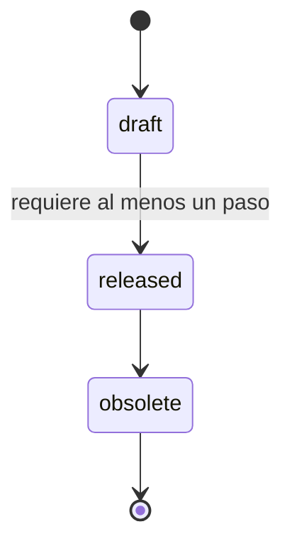

# Modelo de datos

El modelo es genérico a propósito: describe **qué** se produce, **dónde**, **cómo** y **qué
ocurrió realmente**, sin suponer un proceso en particular. Cualquier línea de producción del
laboratorio se representa llenando estas mismas tablas con datos distintos.

El código está en `packages/mes-server/src/mes_server/db/models.py`; los estados y sus reglas,
en `packages/mes-core/src/mes_core`.

## Diagrama entidad-relación



## Entidades

| Entidad | Tabla | Qué representa | Nivel ISA-95 |
|---|---|---|---|
| Usuario | `users` | Persona que inicia sesión, con su rol | Recursos de personal |
| Producto | `products` | Lo que se fabrica, identificado por el código del ERP | Definición de producto |
| Componente de BOM | `bom_items` | Componente y cantidad necesarios por unidad de producto | Definición de producto |
| Estación | `stations` | Lugar donde se ejecutan pasos; cada una tiene su gateway | Recursos de equipo |
| Receta | `recipes` | Versión de cómo se fabrica un producto | Definición de producto |
| Paso de receta | `recipe_steps` | Una operación en una estación, con parámetros y límites | Definición de producto |
| Orden de trabajo | `work_orders` | Solicitud de producir una cantidad de un producto | Programación de producción |
| Unidad | `units` | Pieza individual con número de serie | Rendimiento de producción |
| Registro de ejecución | `execution_records` | Resultado de un paso sobre una pieza | Rendimiento de producción |
| Motivo de paro | `downtime_reasons` | Catálogo de causas de paro | Recursos de equipo |
| Evento de paro | `downtime_events` | Periodo en que una estación no produjo | Rendimiento de producción |

## Conceptos clave

### La receta también es la ruta

Cada paso indica en qué estación se ejecuta, así que el orden de los pasos define el recorrido
de la pieza por la línea. No existe una tabla de rutas separada; puede agregarse en el futuro si
se necesita que varias recetas compartan una ruta.

### Parámetros y límites

Cada paso guarda sus parámetros como una lista JSON:

```json
[
  {"name": "torque", "minimum": 5.0, "maximum": 7.0, "nominal": 6.0, "unit": "N·m"},
  {"name": "angle", "minimum": 30, "maximum": 60, "unit": "°"}
]
```

Los límites son inclusivos y opcionales. Un paso es OK solo si **todos** sus parámetros se
midieron y están dentro de rango. La regla vive en `mes_core.limits`, de modo que el servidor y
el gateway la aplican igual.

### Interlock

El campo `requires_previous_ok` de un paso activa el interlock: una pieza solo puede iniciar ese
paso si todos los pasos anteriores de la receta terminaron OK para ella.

### Versionado de recetas

Una receta nace en `draft`, se libera (`released`) cuando ya tiene pasos y queda congelada. Para
cambiarla se crea una nueva versión y la anterior pasa a `obsolete`. Las órdenes conservan la
versión con la que se produjeron, lo que mantiene la trazabilidad.

### Trazabilidad

Cada ejecución de un paso sobre una pieza genera un `execution_record`, incluidos los intentos
repetidos. Los registros no se modifican. El historial de una pieza es la lista de sus registros
ordenada por hora de inicio.

## Ciclos de vida

### Orden de trabajo



### Unidad



### Receta



## Convenciones

- **Fechas y horas en UTC.** Las pantallas las convierten a hora local al mostrarlas.
- **Enumeraciones guardadas por su valor** (`"operator"`, no `"OPERATOR"`), igual que en los
  mensajes JSON.
- **Nombres de restricciones deterministas** (`uq_`, `ck_`, `fk_`, `ix_`, `pk_`) para que las
  migraciones funcionen igual en SQLite y PostgreSQL.
- **Claves foráneas siempre activas**, también en SQLite.
